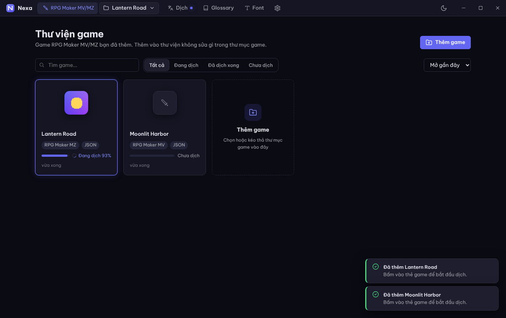
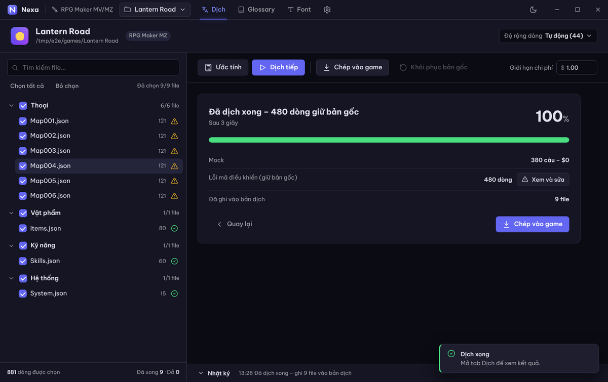
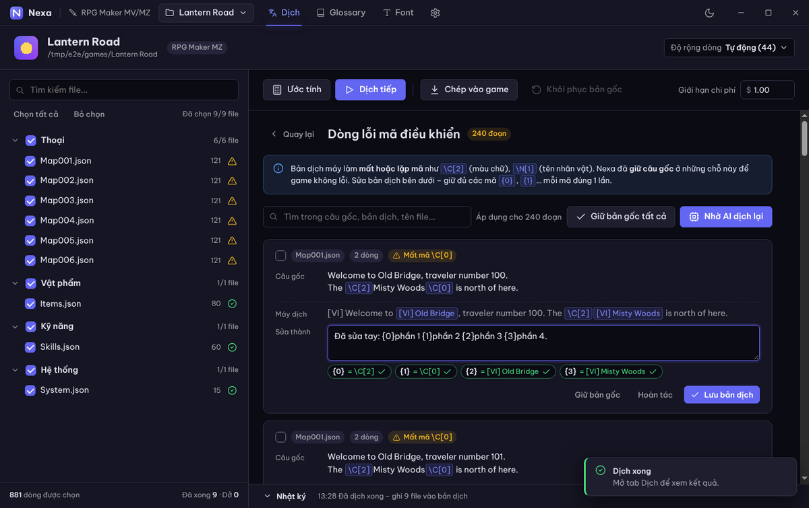
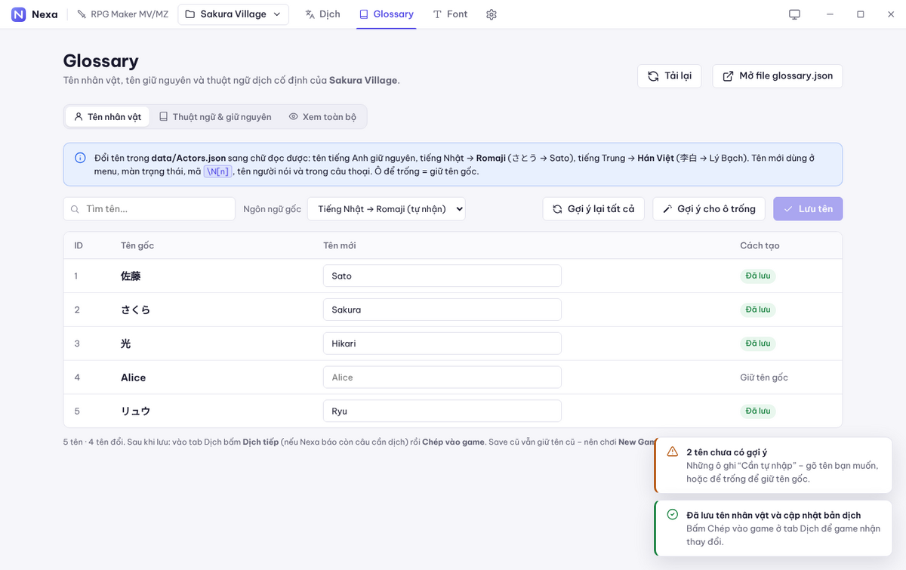

# Nexa Translation

Ứng dụng máy tính (Windows) **dịch máy game RPG Maker MV/MZ sang tiếng Việt**: đọc thoại, vật phẩm, kỹ năng, menu… của game, dịch bằng Google (miễn phí) hoặc Claude AI, rồi chép bản dịch vào game. Bản gốc luôn được giữ lại – muốn trả game về như cũ chỉ cần một nút bấm.



## Tính năng

- **Dịch gần như toàn bộ chữ trong game:** thoại, lựa chọn, chữ chạy, tên khu vực, vật phẩm, vũ khí, giáp, kỹ năng, trạng thái, kẻ địch, nghề nghiệp, menu hệ thống, biệt danh / tiểu sử nhân vật.
- **Google miễn phí** hoặc **Claude Haiku / Sonnet** (dùng API key của bạn). Engine trả phí **luôn hỏi trước** kèm chi phí ước tính, có giới hạn chi phí cho mỗi lần dịch.
- **Giữ nguyên mã điều khiển** của RPG Maker (`\C[2]`, `\N[1]`, `\V[3]`…). Câu nào máy dịch làm hỏng mã sẽ được giữ bản gốc và đưa vào danh sách để bạn sửa tay hoặc nhờ AI dịch lại.
- **Tự xuống dòng** cho vừa khung thoại của game.
- **Glossary:** thuật ngữ dịch cố định, tên giữ nguyên, và **đổi tên nhân vật** (gợi ý Romaji cho tên tiếng Nhật, Hán Việt cho tên tiếng Trung, hoặc tự nhập).
- **Font Doctor:** kiểm tra font của game có đủ chữ tiếng Việt không, thiếu thì thay bằng font Be Vietnam Pro kèm theo.
- **Dịch tiếp được:** mỗi câu dịch xong được lưu ngay. Dừng giữa chừng, hết credit, tắt máy… lần sau bấm Dịch tiếp là chạy tiếp, không dịch lại câu cũ.
- Hỗ trợ game dùng plugin **KNS_CsvReader** (chữ nằm trong thư mục `csv/`).
- Giao diện tiếng Việt, chế độ Sáng / Tối, bản **portable** (không cần cài đặt).

## Tải và chạy

1. Vào mục **[Releases](https://github.com/Pallassad/NexaTranslator/releases)**, tải file `NexaTranslation-<phiên bản>-x64.zip`.
2. Giải nén ra một thư mục cố định, ví dụ `D:\Apps\NexaTranslation`.
3. Bấm đúp **`Nexa Translation.exe`**.

> **Windows báo "Windows protected your PC"?** App chưa được ký số nên SmartScreen cảnh báo. Bấm **More info → Run anyway**.

Có thêm bản `NexaTranslation-<phiên bản>-portable.exe` (chỉ 1 file) – gọn hơn nhưng mỗi lần mở chậm hơn vài giây vì phải tự giải nén.

Chưa có bản trong Releases? Xem [Tự build từ mã nguồn](#tự-build-từ-mã-nguồn).

## Hướng dẫn sử dụng

### 1. Thêm game

Mở app → chọn **RPG Maker MV/MZ** → **Thêm game** → chọn thư mục game (thư mục có `Game.exe`), hoặc kéo thả thư mục vào cửa sổ.
Thêm vào thư viện **không sửa gì** trong thư mục game.

### 2. Ước tính

Mở game → tab **Dịch**. Bên trái là danh sách file theo nhóm (Thoại, Vật phẩm, Kỹ năng…) – bỏ chọn file bạn không muốn dịch.
Bấm **Ước tính** để biết số câu, thời gian và chi phí nếu dùng AI.

### 3. Dịch

Chọn engine ở ô cạnh nút **Dịch**:

| Engine | Chi phí | Khi nào dùng |
|---|---|---|
| **Google (miễn phí)** | Miễn phí | Mặc định. Nếu Google tạm chặn, Nexa hỏi bạn có muốn chuyển sang AI không. |
| **Claude Haiku ($)** | Rẻ | Dịch tự nhiên hơn Google, xưng hô theo ngữ cảnh. |
| **Claude Sonnet ($)** | Đắt hơn nhiều | Chất lượng cao nhất. |

Ô **Tối đa** là số tiền tối đa cho lần dịch này – chạm mức đó Nexa tự dừng. Bấm **Dịch**, theo dõi tiến độ; muốn dừng thì bấm **Dừng** (phần đã dịch được giữ).



### 4. Sửa dòng lỗi (nếu có)

Máy dịch đôi khi làm mất mã điều khiển (vd màu chữ `\C[2]`). Những câu đó được **giữ bản gốc** để game không lỗi, và màn kết quả ghi *"Đã dịch xong – N dòng giữ bản gốc"*. Bấm **Xem và sửa**:

- **Tự gõ bản dịch:** giữ đủ các ô `{0}`, `{1}`… (mỗi ô đúng 1 lần). Ô xanh ✓ là đủ, ô đỏ là thiếu / lặp.
- **Nhờ AI dịch lại** các đoạn đã chọn (hỏi chi phí trước).
- **Giữ bản gốc** nếu chấp nhận để nguyên.



### 5. Chép vào game

Bấm **Chép vào game**. Nexa chạy thử trước và báo file nào sẽ được ghi. File game bị sửa sau khi Nexa đọc (vd bạn tự sửa) được coi là *xung đột* – Nexa hỏi trước khi ghi đè và luôn sao lưu.

Vào game và chơi thử. **Nên chơi New Game:** save cũ có thể giữ tên vật phẩm / nhân vật cũ.

> **Game dùng KNS_CsvReader:** bản tiếng Việt được ghi vào cột ngôn ngữ English – trong game vào Option / Language chọn **English**.

### 6. Khôi phục bản gốc

Bấm **Khôi phục** ở tab Dịch để trả mọi file Nexa đã chép về bản gốc. Bản dịch vẫn còn trong Nexa, chép lại lúc nào cũng được.

## Glossary và tên nhân vật

Tab **Glossary** có 3 phần:

- **Tên nhân vật** – đổi tên trong `Actors.json` sang chữ đọc được. Tên tiếng Anh giữ nguyên; bấm **Gợi ý cho ô trống** để có Romaji (さとう → Sato) hoặc Hán Việt (李白 → Lý Bạch), hoặc tự gõ tên bạn muốn. Tên mới dùng ở menu, màn trạng thái, mã `\N[n]`, tên người nói và trong thoại.
- **Thuật ngữ & giữ nguyên** – thêm thuật ngữ dịch cố định (vd `Strength → Thể lực`), tên không được dịch, và bật / tắt các tên Nexa tự giữ nguyên.
- **Xem toàn bộ** – mọi mục glossary đang áp dụng.

Lưu xong, Nexa cho biết bước tiếp theo: chỉ cần **Chép vào game**, hoặc vào tab Dịch bấm **Dịch tiếp** nếu có câu phải dịch lại.



## Font tiếng Việt

Tab **Font** cho biết font của game thiếu bao nhiêu chữ tiếng Việt (thiếu thì chữ có dấu hiện thành ô vuông hoặc lệch kiểu). Bấm **Dùng Be Vietnam Pro** hoặc **Chọn file font khác…**, rồi **Chép vào game**. Font gốc không bị xóa.

## API key (cho Claude)

Chỉ cần nếu muốn dịch bằng AI.

1. Tạo key tại [Claude Console](https://console.anthropic.com) → **Lấy khóa API** → **Nơi khác**. Key chỉ hiện 1 lần – copy ngay.
2. Trong Nexa: **⚙ Cài đặt → API key → Claude → Nhập key**, dán key. Nexa gọi thử 1 câu rồi hỏi có lưu không.
3. Key được **mã hóa bằng kho bảo mật của Windows** (file `keys.json`) – chỉ giải mã được trên đúng máy và tài khoản Windows đó. Key không bao giờ hiện trong nhật ký hay màn hình.

> Không chia sẻ / chụp màn hình key, không dán key vào chat. Lộ key → xóa key đó trên Console và tạo key mới.

## Cài đặt

**⚙ Cài đặt → Engine dịch:**

- **Engine trả phí dự phòng:** Claude Haiku / Claude Sonnet / Không dùng.
- **Giới hạn chi phí mặc định:** số điền sẵn vào ô "Tối đa" ở tab Dịch.
- **Ngôn ngữ gốc của game:** Tự nhận diện (mặc định), Nhật, Trung, Anh, Hàn. Đổi không làm mất bản dịch đã có.
- **Kiểm tra engine:** dịch thử 1 câu với mỗi engine.

## Dữ liệu được lưu ở đâu

Mọi thứ nằm **cạnh file `Nexa Translation.exe`** – chép cả thư mục là mang theo được:

| File / thư mục | Nội dung |
|---|---|
| `config.json` | Cài đặt (engine, giới hạn chi phí, giá ước tính, câu dặn xưng hô cho AI) |
| `library.json` | Danh sách game trong thư viện |
| `keys.json` | API key đã mã hóa |
| `projects\<game>\` | Bộ nhớ bản dịch, glossary, bản chép gốc, sao lưu |
| `output\<game>\` | Bản dịch đã ghi ra, chờ chép vào game |

**Cập nhật lên bản mới:** tắt app, giải nén bản mới đè lên thư mục cũ – các file dữ liệu ở trên được giữ nguyên.

## Câu hỏi thường gặp

**Google báo bị chặn?** Google tạm giới hạn khi dịch nhiều. Đợi ít phút rồi bấm Dịch tiếp, hoặc đồng ý chuyển sang Claude khi Nexa hỏi.

**Trong game chữ có dấu thành ô vuông?** Font của game thiếu chữ tiếng Việt → dùng tab Font.

**Dòng thoại bị tràn khung?** Chỉnh **Độ rộng dòng** (góc trên bên phải tab Dịch) nhỏ lại rồi dịch lại – câu đã dịch không tốn thêm tiền, chỉ được chia dòng lại.

**Nexa có dịch `plugins.js`, script, ảnh không?** Không. Chữ trong plugin / script / ảnh giữ nguyên để tránh làm hỏng game.

**Chi phí thật bao nhiêu?** Xem ở màn kết quả và trên trang quản lý API. Ví dụ một game ~1.600 câu: Haiku khoảng $0,01–0,02.

## Tự build từ mã nguồn

Cần **Node.js 24** trở lên và Windows (PowerShell).

```powershell
git clone https://github.com/Pallassad/NexaTranslator.git
cd NexaTranslator
npm install
```

| Lệnh | Việc |
|---|---|
| `npm run app:dev` | Chạy app ở chế độ phát triển (sửa giao diện tự cập nhật). Dữ liệu lưu trong thư mục dự án. |
| `npm run dist` | Đóng gói → `release\NexaTranslation-<phiên bản>-x64.zip` và bản portable. |
| `npm run typecheck` | Kiểm tra kiểu TypeScript. |
| `npm test` | Chạy bộ kiểm thử. |
| `npm run dev -- <lệnh> "<thư mục game>"` | Dùng bản dòng lệnh (CLI): `scan`, `estimate`, `translate`, `glossary`, `export`, `restore`, `font`… |

> `npm run dist` xóa và tạo lại `release\win-unpacked` mỗi lần build. **Đừng dùng app ngay trong `release\`** – chép ra chỗ khác, nếu không dữ liệu dịch sẽ mất ở lần build sau.

### Cấu trúc mã nguồn

```
src/core/       lõi dịch: memory (SQLite), glossary, bảo vệ mã điều khiển, engine (Google, Claude...)
src/formats/    bộ đọc từng loại game (rpgm-data: data/*.json, rpgm-kns-csv: csv/)
src/app/        các việc của app (dịch, sửa dòng lỗi, tên nhân vật, chép vào game...) – dùng chung CLI và app
electron/       tiến trình chính của Electron (cửa sổ, IPC, mã hóa key)
shared/api.ts   hợp đồng giữa giao diện và tiến trình chính
ui/             giao diện React
assets/         font Be Vietnam Pro, từ điển Hán Việt
test/           kiểm thử (vitest)
```

## Lưu ý

- Chỉ dùng cho game bạn sở hữu, để chơi cá nhân. Không phát tán lại nội dung game có bản quyền.
- Bản dịch máy có thể sai nghĩa – nên chơi thử và sửa những chỗ quan trọng.
- Luôn có bản gốc để khôi phục, nhưng vẫn nên sao lưu thư mục game trước khi chép bản dịch lần đầu.

## Giấy phép thành phần kèm theo

- Font **Be Vietnam Pro** – SIL Open Font License (`assets/fonts/BeVietnamPro-OFL.txt`).
- Dữ liệu Hán Việt lấy từ gói **hanviet-pinyin-words** – MIT (`assets/hanviet.LICENSE.txt`).
